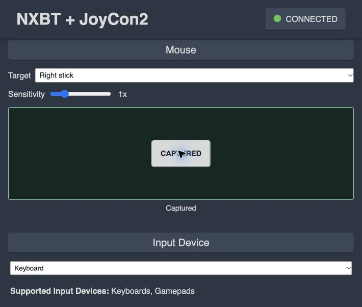

# Changelog

## 2026-10-30

### Controls and Sustained Native Cursor

- Added a bond-preserving `SYNC / Reconnect` action for the right-Joy-Con web
  backend. It restarts the existing paired emulator and does not enter new-device
  pairing or erase private state.
- Added direct Pro Controller `-`, Capture, HOME and `+` taps. Keyboard and Lic2
  WebHID mappings already cover the standard Pro buttons; right-Joy-Con mode
  remains limited to the buttons represented by its physical report.
- Native cursor sessions now run for up to five minutes. Command-mouse mode
  paces and loops only the private opaque motion bed at recorded timestamps,
  while generated optical movement and the bounded A click remain local inputs.
  Browser delta dispatch now runs at approximately 60 Hz.
- The NXBT overlay installer retains an existing private `mouse_capture` path.
  Verification: 98 core tests and 11 installed web-handler tests pass.

### Mouse Click Mapping

- Changed captured mouse left-click from a bounded A tap to a bounded R tap in
  both stick-target and native cursor modes.

### Click-To-Capture and Mouse A

- Mouse capture now activates only after real pointer lock succeeds. A single
  click locks and hides the laptop cursor; Escape releases it. Removed the silent
  drag fallback and report unsupported/denied capture explicitly.
- Later left clicks issue bounded 80 ms A taps, independent of keyboard/WebHID.
  The activation click does not send A. Native cursor mode uses a dedicated
  owner-checked click operation; captured controls and arbitrary buttons remain
  excluded from recorded sensor playback.
- Verified actual pointer capture and Escape release with a physical click in
  the focused Chrome window. Automated/background clicks were rejected by the
  browser; no live A press was sent to the console during verification.
- 95 core tests, 10 web-handler tests and mouse mapping/click-timing checks pass.

### Browser Mouse Surface

- Added an independent mouse surface, target selector and sensitivity slider,
  with pointer lock and drag fallback. Mouse-to-stick targets self-center and
  release on blur, hide, disconnect and capture exit.
- Pro mode exposes either stick; the single right Joy-Con exposes only its own
  stick. No left-half controls are invented.
- Added an explicit 30-second native cursor test using the existing private
  moving-motion diagnostic. Owner-only socket handlers validate/clamp deltas,
  pause normal input during the test, and restore the normal controller afterward.
- Fixed a rapid HCI ownership handoff failure with reset/settle before startup.
  Browser verification confirmed native feature enablement, drag/release and
  restoration of the normal auto-joining controller. Console cursor behavior
  for this new browser surface still needs the owner's visual confirmation.
- Verification: 93 core Python tests, 9 web-handler tests, keyboard mapping
  regressions and pure mouse mapping checks pass. Browser stick drag produced
  nonzero input reports followed by neutral release; a UI screenshot is included.

### Recorded-Motion Cursor Diagnostic

- Added isolated, bounded private compact sensor playback. Captured buttons,
  sticks, power and reserved fields are discarded; only sensor fields enter
  generated neutral reports. No capture arrays are published.
- The owner confirmed a cursor from full sensor playback, then confirmed a cursor
  from command-driven mouse deltas with moving recorded motion. A stationary
  baseline experiment did not produce a cursor. Delta sizes also differed, so
  the exact required motion fields remain unresolved.
- Default controller behavior remains buttons/stick-only. Recorded diagnostics
  are explicit Linux serve options, limited to 30 seconds, not live gyro support.
- All 92 Python tests pass, including sensor-field isolation, playback bounds,
  feature gating, timing validation and rejection of diagnostic button commands.

### Compact Capture and Mouse Follow-Up

- Added native `--report right` capture with distinct frame labels and self-tests.
  Saved 405 stationary and 750 moving compact reports privately; no report arrays
  or device identifiers are distributed.
- Added a bounded 250 ms optical contact lease without replaying relative deltas,
  and an optional validated raw `--surface` byte for command-driven experiments.
  Release, feature disable and readiness loss clear contact.
- Tutorial tests with the contact lease and raw surface value 50 still produced
  no visible cursor. No live gyro capability is advertised; candidate compact
  sample interpretations remain unverified.
- All 83 Python tests and native reader self-tests pass.

### Native Sensor Capture

- Increased the native reader's bound to 2048 reports so human movement tests
  can use the requested duration, and retain explicitly labelled partial captures
  after link loss. Added native regression checks for both behaviors.
- Completed a subsequent native movement recording with 748 reports containing
  optical motion on both axes and changing gyro readings. Physical sensor capture
  works; this is not a claim of live compact-report mouse/gyro emulation.
- Added a bounded, capture-only macOS CoreBluetooth helper and build wrapper;
  native discovery/file-safety self-tests pass, and a requested five-second
  recording (about 6.3 seconds including startup reports) saved 401 common input
  reports privately without requesting pairing or calibration
  writes. No captured report arrays are published.
- Improved Linux capture diagnostics, one-format subscriptions, 500 ms feature
  initialization spacing, explicit optional compact-session setup and temporary
  random-address testing. Those Linux attempts still produced no input reports.
- Corrected Bumble descriptor lookup to use its real `type` attribute and added
  real-descriptor, disconnect, output-limit and random-address regression tests.
- All 79 Python tests pass. Native mouse/gyro emulation is still not verified;
  captured stationary sensor data is not treated as a calibration reference.

### Sensor Hardware Diagnostics

- With testing available again, observed the console enabling native mouse
  feature 0x10. Neither isolated deltas nor a six-second burst produced a cursor
  in How to Use Mouse Controls; the feature remains experimental/not usable.
- Tested R-only registration: an upright L+R prompt appeared, but A did not
  complete registration. SL+SR restored normal horizontal operation.
- Added a bounded, private physical sensor reader: fixed runtime feature commands,
  common/right report subscriptions, 15-second/512-frame limits, owner-only output,
  no pairing/flash/firmware operations. Physical capture is pending setup.
- Cleared negotiated feature state on disconnect to avoid stale mouse status.
- All 75 Python tests pass, including a mocked capture lifecycle/permissions test.
  Restored HOME and normal NXBT/BlueZ after diagnostics; no parental settings changed.

### Experimental Native Sensor Work

- Added opt-in native optical-mouse fields to right report 0x08, feature bit 4
  negotiation and `j2 start --experimental-mouse` / `j2 mouse` commands.
- Mouse deltas are one-shot, bounded, short-lived and independent of held
  buttons/sticks. Feature disable/disconnect/release discard pending movement.
  No mouse-to-stick mode or browser pointer capture was restored.
- Added an offline, tested common-report IMU encoder. Live compact-report gyro
  remains unimplemented and is not advertised; no captured gyro frames copied.
- Console testing was deferred because its daily play-time limit was reached.
  The owner's proposed R-only vertical registration is documented as unverified.
  See [sensor status and commands](docs/SENSORS.md).
- Verification: all 71 Python core/bridge/CLI tests pass in the Linux VM;
  native mouse and R-only registration remain pending hardware verification.

### Input Diagnostics And Mapping

- Verified A/B/X/Y, R/ZR, PLUS, stick click and SL/SR in the Switch's own
  controller-button test, observed through Elgato. HOME and four-direction menu
  navigation were also checked; C/GameChat was deliberately not opened.
- Added an on-screen tap for every right-half button and four 150 ms direction
  controls. Fixed keyboard stick clicks and the reversed R/ZR key mapping.
- Added an independent printed/sideways face-button selector. Printed X confirms
  and printed A goes Back when the half is sideways; conventional sideways A/B
  can now be selected without changing raw CLI/JSON button names.
- Hid Pro-only keyboard rows in right-half mode and added browser keyboard
  regression tests to CI. Published the input matrix and console test screenshot.
- Verification: 59 Python tests, seven mocked web tests and two JavaScript tests
  passed. The console blocks stick calibration while held horizontally, so full
  analog-range/diagonal behavior remains software-tested, not visually certified.

### Combined Interface

- Published a combined NXBT web overlay with Pro Controller / Joy-Con 2 (R)
  backend selection, isolated BLE process, session ownership and adapter handoff.
- Preserved the existing keyboard, browser Gamepad and Lic2 WebHID input paths.
- Added a selectable single-stick source, raw/sideways orientation, explicit
  SL/SR and C/GameChat controls; keyboard mappings are `-`, `=` and `0`.
- Added automatic SL+SR registration after a two-second initialization grace,
  with input blocked until the 250 ms pulse releases. Registration was observed
  through the owner's Elgato capture after reconnecting.
- Added an input refresh lease, bounded JSON sequences and orderly backend stop.
- Published wake scanner/replay/configuration helpers without personal captures,
  addresses, keys or firmware; documented adapter-specific risks and recovery.
- Updated setup, hardware evidence, architecture, licensing and provenance.
- Removed a temporary mouse-to-stick mode at the owner's request. Native Joy-Con
  2 optical-mouse reports remain unimplemented future work.
- Verification: 55 core/bridge unit tests and six mocked web-handler tests passed
  in the existing Linux VM. Real console tests cover registration, A/B/HOME and
  movement, not all controls or sustained gameplay.

## 2026-10-29

- Established experimental right-half pairing, private calibration import,
  encrypted bond reload and observed 5 ms / 15 ms connections on one RTL8761BU.
- Added timed CLI input, calibrated stick coordinates, local owner-only command
  socket, JSON sequences and the Mac-to-Vagrant `scripts/j2` wrapper.
- Added HCI transmit-queue draining after delayed HOME delivery was interpreted
  as a hold. A subsequent 50 ms HOME tap returned from Settings to HOME.
