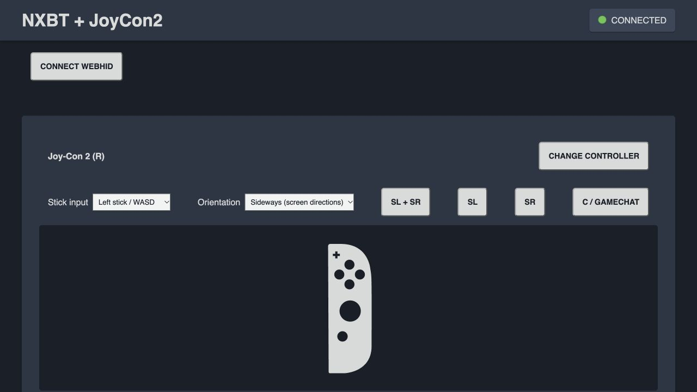

# JoyCon2-Emulator

An experimental Joy-Con 2 BLE emulator for Linux and USB-passthrough virtual
machines, including Apple Silicon Macs. The goal is one software stack for
pairing, waking, reconnecting, and sending controller input to a Nintendo Switch 2.

**Working experimental right-Joy-Con input on one tested Switch 2 setup.**
Sleep wake, registration, A/B, short HOME and stick movement have been confirmed
by the console owner. This is not complete Joy-Con emulation or broad hardware
certification. Keep an existing controller available and do not buy hardware on
the assumption that another adapter revision will work. No Nintendo firmware, flash dumps, personal
Bluetooth captures, or pairing keys are distributed.

## Start Here

- [Combined NXBT web interface](integrations/nxbt/README.md): choose Classic
  Pro Controller or BLE Joy-Con 2 (R), with keyboard, Gamepad and Lic2 WebHID
  input, automatic SL+SR registration and C control. The Mouse surface maps to
  either Pro stick, the right Joy-Con stick, or a bounded experimental native
  cursor session using private recorded motion. Generated mouse-only reports
  still do not work independently.
- [Command control](#command-control): timed buttons, calibrated stick input and
  JSON sequences, independent of the browser.
- [Sleep wake tools](integrations/wake/README.md): the tested RTL8761BU wake
  prototype, using your private capture and restoring the adapter afterward.
- [Hardware evidence](docs/HARDWARE.md): successful tests, regressions and limits.
- [Input test matrix](docs/INPUT-TESTS.md): every supported button, direction and
  the distinction between software checks and console-visible results.
- [Changelog](CHANGELOG.md): implementation milestones and verification.

The combined web integration is newly implemented and separately tested; the
physical input confirmations above were obtained through the command backend.
Automatic registration and browser keyboard input were subsequently checked
through the owner's capture card. Native mouse now has a separate bounded
recorded-motion test mode; this is not generated/live gyro support.



## Status

| Component | Current state |
| --- | --- |
| Nintendo discovery/reconnect/wake advertisement encoding | Implemented, unit tested |
| Right Joy-Con 2 button/stick report encoding | Implemented; SL+SR registration, A/B, short HOME and movement confirmed |
| Nintendo command framing and pairing challenge/response | Implemented; completed exchange with one console |
| Vendor GATT database with expected attribute handles | Implemented on Bumble; layout tested |
| Linux BLE peripheral | Bounded diagnostics and persistent command service implemented |
| Console discovery and initial command exchange | Console accepted metadata/version queries and advanced through calibration reads |
| Stock USB adapter sleep wake | Local prototype and revised connectable/three-burst test both woke one console |
| Sleep wake after physical Joy-Con docking | Revised connectable three-burst prototype worked; broad repeat reliability unproven |
| 5 ms connection interval on Realtek RTL8761BU | Observed on the test adapter, including an encrypted connection; sustained gameplay untested |
| Console initialization, calibration/flash responses | Generated metadata, allowlisted private calibration import, erased user-calibration slots; incomplete overall |
| Bond reload and LTK interoperability | Implemented per-address keys; encrypted reconnect observed after process restart; long-term reliability untested |
| Player LEDs and vibration requests | Virtual state/sink only, no physical output |
| Opt-in button smoke tests | HOME 50 ms, join/A/B 250 ms; join confirmed; old HOME pulse opened Quick Settings |
| Command-driven buttons/right stick | Timed release, sequences and private local socket implemented; 50 ms HOME tap confirmed after transmit-queue fix; stick behavior unverified |
| NXBT web integration | Pro / Joy-Con 2 (R) selector; bounded input bridge; one backend per adapter |
| Left/right combined controller | Not implemented; neither one-radio nor two-radio pair is validated |
| Native optical mouse | Command mouse produced a cursor with private moving-motion playback; generated mouse-only reports still fail |
| Gyro | Offline common codec and private recorded-motion diagnostics; no generated/live gyro support |
| Native Mac sensor capture | Common and compact right-half reports captured privately, stationary and moving; no pairing requested |
| Physical rumble, NFC, firmware updates | Not implemented |

This is **not a port of XD2Joy firmware to a USB dongle** and is not an NXBT fork.
It uses [Bumble](https://github.com/google/bumble) for the BLE host/GATT engine.
Protocol research and adapted NXBT code are credited in [CREDITS.md](CREDITS.md).

## Tested Setup And Limits

Apple Silicon Mac, VirtualBox Ubuntu 22.04 ARM64/Linux 5.15, Bumble 0.0.235 and a
TP-Link USB 2357:0604 identified as Realtek RTL8761BU with stock Linux firmware.
The BLE backend has observed encrypted 5 ms and 15 ms links. It does not use the
Mac's internal Bluetooth or native CoreBluetooth APIs.

One right half means one stick and right-side buttons, not a Pro Controller's
full two-stick layout. Live gyro, NFC and physical rumble are absent. Experimental
native mouse and sensor limitations are described in [sensor inputs](docs/SENSORS.md). Positive
raw X moved down when registered sideways; opt-in `sideways-right` mapping
produced screen-right movement, but the other mapped directions still need
isolated checks. A 200 ms movement traveled farther than intended; use short
pulses for menu navigation and do not assume exact one-item movement.

Both Joy-Cons could be a future feature. A pair needs distinct identities,
left-side protocol/calibration support and concurrent BLE links. Whether one
RTL8761BU can provide the required advertising identities and timing is untested.
Two adapters would give each half its own radio, but do not by themselves add
missing left-half software. Do not purchase another adapter as a guaranteed fix.

## Install And Run Tests

Python 3.10+ is required. On Debian/Ubuntu, install `python3-venv`, `bluez`,
and `usbutils` using your package manager first. No hardware is needed for tests.

```sh
git clone https://github.com/coopermeyer465-prog/JoyCon2-Emulator.git
cd JoyCon2-Emulator
python3 -m venv .venv
. .venv/bin/activate
python -m pip install -e .
python -m unittest discover -s tests -v
joycon2-emulator doctor
joycon2-emulator advertisement --side right
```

`advertisement` only prints hex; it does not transmit. `doctor` performs
read-only checks. Normal macOS CoreBluetooth APIs are not this project's backend.
For the HCI-socket backend on a Mac, run inside Linux with a dedicated USB
Bluetooth adapter passed through. Never pass through the Mac's internal radio.

## Experimental Peripheral Lab

**This is not a full gameplay controller yet.** Diagnostic runs collect missing
initialization steps; command control below supplies tested basic right-half input.
Use the adapter's own address, NOT the address of a physical Joy-Con.

1. Make sure your USB adapter has working Linux firmware and appears in `hciconfig -a`.
2. Stop software using that adapter. The example below assumes systemd and the
   optional `nxbt-web` service; adapt service names for your installation.
3. Open Controllers > Change Grip/Order on the console only when testing discovery.
4. Run the lab for at most 60 seconds. Unknown initialization commands are logged
   and deliberately not acknowledged as implemented.

```sh
sudo bash
trap 'systemctl start bluetooth; systemctl start nxbt-web 2>/dev/null || true' EXIT
systemctl stop nxbt-web 2>/dev/null || true
systemctl stop bluetooth
hciconfig hci0 down
.venv/bin/joycon2-emulator serve --experimental --address AD:AP:TE:RS:MA:CC --seconds 60
exit
```

Replace `AD:AP:TE:RS:MA:CC` with the actual adapter address (the placeholder is
deliberately invalid). Do not run wake, NXBT, or a second emulator simultaneously
on the same adapter. The experimental backend handles one right Joy-Con only.
It stores newly finalized pairing material under `.state/bond.json` with owner-only
permissions and reloads them on startup. The console can supply different keys for
its two host addresses; these are stored separately. Do not clear this file just
to rerun the lab. Existing version-1 single-key files migrate when next saved.

By default the lab sends neutral reports only after the console subscribes and
enables the implemented input features. To send one explicit SL+SR registration
pulse, add `--test-button join` to `serve`. Alternatives are `home`, `a` and `b`.
The pulse starts two seconds after the subscribed report stream starts, lasts
50 ms for HOME or 250 ms for join/A/B, then releases. The earlier 250 ms HOME
test was interpreted as a hold and opened Quick Settings. After adding HCI queue
drain, a 50 ms command-driven tap returned from Settings to HOME. Keep the console
on the appropriate screen before starting.
This is a diagnostic input test, not the live Lic2/WebHID relay.

## Command Control

After initial pairing and private calibration import, the backend can accept
timed button/stick commands. This emulates **one right Joy-Con**, not a complete
two-stick controller. Supported buttons: `A B X Y R ZR PLUS STICK HOME C SL SR`.
There is no left stick, D-pad, L or ZL, and no video capture or power switching.

For a Mac using an existing Vagrant Linux VM, configure the wrapper once. Replace
the deliberately invalid address with the USB adapter's own address. The guest
must already have this project, its dependencies, saved bond and calibration.
The paths below are examples; use your existing guest Python environment.

```sh
./scripts/j2 configure --vm-dir /path/to/vagrant-project \
  --guest-dir /home/vagrant/JoyCon2-Emulator \
  --guest-python /home/vagrant/JoyCon2-Emulator/.venv/bin/python \
  --address AD:AP:TE:RS:MA:CC
./scripts/j2 start
./scripts/j2 status
./scripts/j2 stick --x 0.5 --y 0 --duration 0.15
./scripts/j2 press HOME --duration 0.05
./scripts/j2 release
./scripts/j2 stop
```

Wake the console and wait for `"ready": true` before sending input. An initial
registration may require Change Grip/Order and `./scripts/j2 press SL SR
--duration 0.25`. The wrapper resumes the VM if necessary, stops BlueZ/NXBT and
starts a transient `joycon2-command.service`. Stopping or exiting that service
restores BlueZ/NXBT. Local configuration is private in `.state/mac.json`.
On the original development Mac, the separate wake shortcut stops this service
before using the adapter; run `./scripts/j2 start` afterward to resume control.
The public repository does not include that machine-specific wake shortcut.

Stick coordinates are -1 to 1, positive Y is up, and imported factory calibration
maps them to report coordinates. Each command replaces the previous command or
sequence. Inputs automatically return to neutral after their duration, on loss
of readiness, and on orderly shutdown. Per-step duration is 0.02 to 10 seconds;
sequences allow up to 256 steps and 300 seconds total. These are host-side timings,
not guarantees of radio delivery or game latency. A successful reply means the
input was queued, not that the console acknowledged its visible effect.

Axes default to `--orientation raw` (physical right Joy-Con coordinates). When
registered as a single sideways right Joy-Con, the console may rotate them:
positive raw X moved down in the development test. Use the opt-in orientation
below for screen-relative right/up commands. This applies the inverse rotation
`raw_x = -y, raw_y = x`; it still needs a four-direction console check. Button
names are unchanged, and status reports the transformed raw coordinates.

```sh
./scripts/j2 stick --orientation sideways-right --x 0.75 --y 0 --duration 0.2
```

`./scripts/j2 sequence examples/button-stick.json` sends a JSON step array with
optional `buttons`, `x`, `y`, `orientation` and `duration` fields. **That example presses A**;
inspect it before running it on a console. Sequences avoid one SSH round trip per
step. `release` cancels pending input immediately at the host scheduler.

For native Linux, add `--control-socket .state/control.sock --seconds 0` to
the calibrated `serve` invocation above, then use a second terminal:

```sh
sudo .venv/bin/joycon2-emulator control --socket .state/control.sock status
sudo .venv/bin/joycon2-emulator control --socket .state/control.sock press HOME --duration 0.05
sudo .venv/bin/joycon2-emulator control --socket .state/control.sock stop
```

The socket is owner-only (0600), accepts bounded local JSON requests and opens no
TCP listener. Continuous serving requires the socket; diagnostic pulses cannot
be combined with command control. Keep keys, calibration and `.state` private.

## Private Calibration Capture

Without calibration data the lab stops at the first unsupported factory read.
The optional reader connects to your owned right Joy-Con without requesting SMP
or Nintendo pairing. It issues only memory-read command 02/04 for four 64-byte
factory blocks at 0x13080, 0x130C0, 0x13100 and 0x13140. It never requests the
pairing-key region or firmware banks and exposes no flash-write operation.

Stop BlueZ/NXBT and bring hci0 down as in the lab example. Detach the physical
Joy-Con, hold SYNC until its LEDs cycle, then run these commands in that same
root shell, replacing the placeholders with real local addresses:

```sh
.venv/bin/joycon2-emulator capture-calibration --peer JO:YC:ON:AD:DR:SS --output .state/factory-calibration.json
.venv/bin/joycon2-emulator serve --experimental --address AD:AP:TE:RS:MA:CC --calibration .state/factory-calibration.json --seconds 60
```

The file is owner-only, excluded from Git and not shipped with this repo. The
reader refuses to overwrite it. The importer accepts only those four exact
blocks, so a firmware dump or pairing-key file cannot be imported through it.
The emulator retains generated serial/colors and the USB adapter's own identity.
Neutral reports use the imported primary stick center rather than assuming 2048.
Custom user-calibration slots are represented as erased; no physical calibration
is changed. The meaning of some factory fields remains unknown, so compatibility
is experimental and is not a claim of complete, faithful Joy-Con emulation.

## Wake Prototype And Regression

The separately developed local prototype uses an RTL8761BU USB adapter to replay
a captured wake advertisement with the originating controller's public address.
An initial test woke the console, but a later test after attaching the physical
Joy-Con to the console did not. A fresh capture matched the original exactly.
Changing to connectable advertisements in three short bursts woke the console
in a subsequent user-confirmed test. This changed two variables and does not
isolate the cause or prove long-term reliability. Docking
must not be assumed to rotate the address, keys, or packet without evidence.
The replay, read-only scanner and Realtek configuration helper are now published
under [integrations/wake](integrations/wake/README.md). Machine-specific launchers,
private captures and configuration backups are not distributed.

To inspect an existing local capture produced by the prototype:

```sh
joycon2-emulator inspect-capture /private/path/to/capture.json
```

Keep captures private. Next, repeat sleep/wake cycles with docking/undocking and
host restarts, then isolate advertising PDU type from burst timing. Wake success
alone does not prove that full controller emulation works.

## Development

See [architecture and milestones](docs/ARCHITECTURE.md),
[hardware evidence](docs/HARDWARE.md), and [contribution guidelines](CONTRIBUTING.md).
Code is GPL-3.0-only. Dependencies retain their own licenses. Nintendo and Joy-Con
are Nintendo trademarks; this project is unofficial and unaffiliated.
