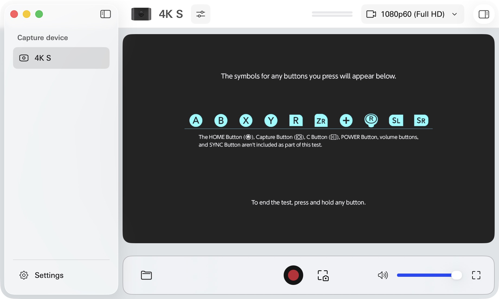

# Input Verification (2026-10-30)

Test setup: existing Apple Silicon Mac/VirtualBox Linux VM, stock RTL8761BU,
Bumble 0.0.235, one emulated right Joy-Con 2, with the Switch observed through
the owner's Elgato 4K S. No settings, parental restrictions or calibration values
were changed. No GameChat session was opened.

| Input | Software verification | Console observation |
| --- | --- | --- |
| A, B, X, Y | Bridge, timed state, exact report bit, release | All four appeared in Test Controller Buttons |
| R, ZR | Same, plus corrected keyboard 8/9 mapping | Both appeared in the button test |
| PLUS | Bridge, state, report, release | Plus appeared in the button test |
| Stick click | Both selected browser-stick sources, report, release; fixed nested keyboard field | R-stick-click symbol appeared in the button test |
| SL, SR | Individual, chord, ownership and report checks | Both appeared in the button test; registration also verified |
| HOME | Exact bit, bounded release, shorter timing | Returned from the calibration warning to HOME |
| C / GameChat | Bridge, state, exact bit, handler allowlist, release | Not opened; the console diagnostic explicitly excludes C |
| Screen left/right/up/down | Both source sticks, raw and sideways transform | All four moved menus in their intended directions |
| Center / release | Expiring lease and sequence release | Menu movement stopped after each pulse |
| Diagonals and normalized full range | Both source sticks and factory-range unit tests | Not visually certified; stick-calibration display rejected horizontal grip |
| Native optical mouse | Opt-in signed report fields, feature gating, one-shot/expiry/socket tests | Feature 0x10 enabled on reconnect; single deltas and a six-second burst did not display a cursor in How to Use Mouse Controls |
| R-only vertical registration | Existing bounded physical R command | Upright L+R prompt appeared; A did not finish; SL+SR restored working horizontal registration |

## Mapping Fixes

- Keyboard T/Y now set the selected nested stick's PRESSED field, instead of
  creating unused top-level LS_PRESS/RS_PRESS flags.
- Keyboard 8 is R and 9 is ZR, matching the displayed mapping.
- Every supported right-half button has an on-screen tap command; four arrow
  controls send 150 ms stick pulses. Keyboard/gamepad paths still support holds.
- Face-button layout is independently selectable. Printed labels preserve raw
  physical A/B/X/Y. Sideways A/B/X/Y maps logical A/B/X/Y to physical X/A/Y/B.
  Printed X confirmed Settings and printed A acted as Back during capture tests.
  The new layout is unit-tested for both live input and tap commands.
- Stick orientation is a separate selector and does not change the CLI's raw
  button names or sequence fields. JSON sequences always name physical buttons.

## Scope

This right-half backend does not expose a native left stick, D-pad, L/ZL, MINUS
or Capture button. Those remain available in NXBT's Pro Controller mode, not as
invented buttons in the right-half report. GL/GR charging-grip buttons, gyro,
physical vibration, NFC and a second Joy-Con remain unimplemented. The experimental
optical mouse report path exists, but has not produced a cursor on the console.
Unit tests are not proof of physical controller hardware, every HID device or
every gameplay timing path. The full-range calibration view was deliberately
not unlocked by changing grip, and no recalibration was performed.
