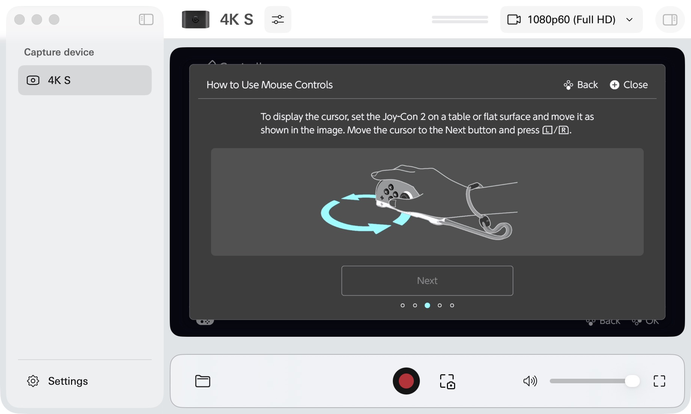

# Experimental Sensor Inputs

## Status

- Native relative optical-mouse fields in right report `0x08`: implemented,
  command-driven, opt-in, software-tested. Console feature enablement was observed,
  but **no cursor appeared** in the console's mouse tutorial. Not usable yet.
- Desktop pointer capture/browser mouse mapping: not implemented. The removed
  mouse-to-stick mode remains removed.
- Gyroscope/accelerometer: offline `common_motion()` encoder only, for the
  documented 18-byte IMU block in common report `0x05`. It is not connected to
  the BLE stream and is not a usable console gyro input.
- Compact `0x08` motion data: not implemented. IMU feature bit 2 stays disabled.
- Existing buttons/stick and default feature negotiation remain unchanged.

The optical surface byte is incompletely documented. Our experimental convention
uses `0` for contact and `255` for lifted, as demonstrated in XD2Joy; it is not
calibrated height, surface quality or confirmed Switch behavior.



## Command-Driven Native Mouse

Run only when testing is allowed on the console. This does not bypass play-time
limits, enable mouse in games without support, or change console settings.
After pairing, stop any existing controller session before opting in:

```sh
./scripts/j2 stop
./scripts/j2 start --experimental-mouse
./scripts/j2 status
```

For Linux `serve`, add `--experimental-mouse` to the existing calibrated command
with `--control-socket .state/control.sock`. The Mac wrapper above passes it
through to the same BLE backend. Default NXBT web startup does NOT enable it.

Both `ready` and `mouse_enabled` must be true before mouse commands are accepted.
The latter means the console selected and enabled feature bit 4; the emulator
does not force it on locally. A mouse-aware screen/game may be required. If
feature/configuration commands are rejected in the journal, save the command IDs
and lengths, not private keys or dumps, for further protocol work.

```sh
./scripts/j2 mouse --dx 12 --dy -6
./scripts/j2 mouse --lifted
./scripts/j2 release
./scripts/j2 stop
```

Deltas are raw signed 16-bit counts in native sensor axes, not screen pixels or
stick coordinates. Each accepted request is placed in one report at most, then
returns to zero movement/lifted. Undelivered movement expires after 250 ms.
Only one movement may be pending: another is rejected rather than accumulated.
Status does not consume it, and a mouse request does not replace held buttons
or a stick sequence. Release, disconnect, registration and feature disable prevent
pending movement from being replayed. Success is a queue receipt, not a console
acknowledgement; transport failure can still lose a delta. No automatic retry.
Restart without the opt-in flag to restore the default buttons/stick-only mode.

## Gyro Work Remaining

The common-report encoder has explicit microsecond timestamps, temperature,
acceleration in g and angular velocity in degrees/second, with finite/range
checks and signed little-endian tests. It does not supply factory biases.

The console currently subscribes to compact report `0x08`, whose packed motion
format is not fully described in the primary protocol reference. XD2Joy's current
gyro implementation edits captured motion frames and quaternion fields. No
captured frames or Nintendo XData are copied here. A complete generated compact
codec, coherent timing/orientation and feature-configuration support are required
before advertising gyro or adding a live gyro command. A correct `0x05` block
alone does not prove the console will accept gyro input.

## Grip Test Result

The owner suggested pressing **R** after connecting to register the right half
vertically instead of SL+SR. During the Elgato-observed test, a 150 ms R pulse
produced the upright L+R pair prompt in slot 1, but an A pulse did not finish
registration. SL+SR then registered the single horizontal half and X confirmed
normally. This does not establish usable vertical single-half operation;
default automatic web registration remains SL+SR. No calibration was changed.

## Private Sensor Capture

The next investigation compares the optical surface and motion fields with an
owned physical right Joy-Con, detached, in SYNC mode and flat on a table.
Stop the emulator and other adapter owners before running the tool in Linux:

```sh
sudo .venv/bin/joycon2-emulator capture-sensors --peer JO:YC:ON:AD:DR:SS \
  --output .state/sensors-flat.json --seconds 5
```

Use the physical controller's address for this direct reader, not the emulator's
address. The tool selects the demonstrated runtime feature mask `0xFF`, subscribes
to **one** input format (common by default), then disables reporting and
disconnects. The mask includes vibration capability, but no vibration output
command is sent. Feature commands have a 500 ms initialization gap. The tool
does not request pairing, flash access, calibration changes or firmware updates.
Duration is limited to 1..15 seconds and at most 512 reports. Captures are written
owner-only and existing files/symlinks are refused. Keep them in gitignored
`.state`; do not publish captured report arrays. This reader's software tests
do not establish that every physical firmware permits unpaired sensor streaming.

For a separate experimental compact-channel attempt, add `--report right
--console-session`. This writes the fixed runtime session-start value and report
rate descriptor, sends an initial status query, and sends feature commands through the combined channel with
a zeroed output prefix. It does not implement the console's complete initialization
sequence and is not a guarantee of streaming. On the initial unpaired common-path
attempts, the physical controller acknowledged feature commands but sent no input
notifications; direct input reads returned READ_NOT_PERMITTED. No capture file
was written. Connection failures leave the output untouched and report the
disconnect reason when available.

`--random-address` tests a temporary random central address, without cloning a
controller or storing a bond. Both public-address and random-address common
attempts, and the minimal compact-session attempt, returned no input reports on
the development Linux setup. This is a capture limitation, not proof that pairing
is required or the sensors are absent.

## Native Mac Reader

A separate native CoreBluetooth reader successfully captured 401 common input
reports from the owned right Joy-Con without requesting pairing. This avoids the
Linux/USB capture problem; it does **not** move controller emulation to macOS or
establish a working optical-mouse/gyro emulator.

The native helper requires macOS and Xcode Command Line Tools. It uses Apple's
frameworks and no downloaded packages. The wrapper compiles and ad-hoc signs the
local helper in gitignored `.state`. macOS may ask for Bluetooth permission for
the helper or calling application. It does not need Accessibility, input-monitoring,
root access, a HID driver or a device-pairing confirmation.

```sh
./scripts/capture-mac-sensors --self-test
./scripts/capture-mac-sensors --output .state/sensors-native-stationary.json --seconds 5
```

Put exactly one owned right Joy-Con into SYNC mode first. Discovery filters for
the right-half product and a zeroed reconnect-host field; multiple matching
controllers are refused. The reader scans for eight seconds, connects to the
common-input service, subscribes, and sends the two reporting commands 500 ms
apart. The complete run has a 45-second timeout and at most 512 frames. It then
disables runtime reporting and disconnects. Capture files use mode 0600 and are
never overwritten; no addresses, pairing keys or firmware are recorded.

Stationary data is a baseline at an **unknown tilt**, not a recalibration. For
optical samples the sensor edge must face the table as in mouse mode; laying the
controller face-up leaves the sensor away from the surface. Move it only once
the helper announces recording. The first capture contained plausible stationary
acceleration/gyro readings and lifted optical readings; optical motion and live
emulated gyro still require further tests. Captures remain private and are not
distributed in this repository.

## References

- [ndeadly HID report layouts](https://github.com/ndeadly/switch2_controller_research/blob/master/hid_reports.md)
- [ndeadly feature commands](https://github.com/ndeadly/switch2_controller_research/blob/master/commands.md#command-0x0c---feature-select)
- [XD2Joy source](https://github.com/desktopsetup/XD2Joy/blob/main/firmware/src/main.c)
- [JoeGeC common and console input sessions](https://github.com/JoeGeC/joycon2android/blob/main/docs/protocol.md)
- [seitanmen native Mac BLE reader](https://github.com/seitanmen/Joycon2forMac)
