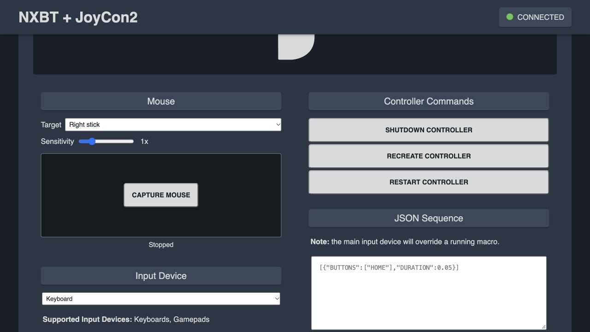

# Combined NXBT Web Interface

This optional overlay keeps NXBT's Classic Bluetooth Pro Controller backend and
adds this project's BLE Joy-Con 2 (R) backend in the same web UI. It includes the
existing Lic2 WebHID decoder. Original NXBT assets, dependencies and services are
still required. Adapted upstream web files retain the MIT notice in LICENSE.NXBT.

## Install In Your Linux VM

First install NXBT from https://github.com/Brikwerk/nxbt, and separately prepare
JoyCon2-Emulator, its isolated Python environment, private bond and calibration
as described in the main README. Never upgrade NXBT's system cryptography to
install Bumble; use a separate environment. The web bridge uses only stdlib and
launches the BLE process with the explicitly configured interpreter/PYTHONPATH.

Run the installer as root in Linux, adapting these example paths and replacing
the intentionally invalid address with the USB adapter's OWN address:

```sh
sudo python3 integrations/nxbt/install.py \
  --nxbt-root /path/to/nxbt \
  --project /path/to/JoyCon2-Emulator \
  --python /path/to/JoyCon2-Emulator/.venv/bin/python \
  --address AD:AP:TE:RS:MA:CC
sudo systemctl restart nxbt-web
```

For an isolated target-directory installation instead of a venv, use
`--python /usr/bin/python3 --pythonpath /path/to/isolated-dependencies`.
Configuration is written owner-only to `/etc/nxbt-joycon2.json`. Existing web files
are backed up under NXBT's `.joycon2-backups/` before replacement. Do not publish
that backup directory or the private configuration. Reinstalling preserves a
new backup rather than deleting old files. Restart the web service afterward.

For systemd cleanup when the web process stops, add this service drop-in using
`sudo systemctl edit nxbt-web`, then `sudo systemctl daemon-reload`:

```ini
[Service]
ExecStopPost=-/usr/bin/systemctl stop joycon2-web.service
```

The original development VM already has this cleanup configured.

Open http://127.0.0.1:8000/ on your Mac using NXBT's existing VM port forwarding.
Keep that forwarding restricted to localhost. The root-run web interface is for
local trusted use only, not public Internet or untrusted LAN exposure.

## Backend Selection

Choose **Pro Controller** for original NXBT or **Joy-Con 2 (R)** for Bumble.
Use **Change Controller** to stop the current controller and return to selection.
The radio cannot run both stacks at once; another session using it must disconnect.
The BLE backend runs as transient `joycon2-web.service`, not inside NXBT's Python
environment. It stops BlueZ while active and restores BlueZ when stopped.

Joy-Con mode has one physical right stick. Select whether the browser's left
stick/WASD or right stick/arrows drives it. Choose sideways screen directions or
raw axes. Face buttons, R/ZR, PLUS, HOME and the selected stick press are forwarded.
Every supported right-half button has an on-screen tap control, including stick
click, plus four directional stick controls. Keyboard T/Y correctly press the
selected stick; 8/9 are R/ZR. Face-button layout is a separate selector: printed
labels preserve physical names, while Sideways A/B/X/Y maps logical A/B/X/Y to
physical X/A/Y/B so sideways menu confirm/back can use conventional A/B. The
printed-label mode remains the default. JSON sequences and CLI commands always
name physical buttons, independently of this browser mapping.
Left-half-only buttons are ignored, not advertised as supported. The web service
uses `--auto-join`: after encryption, subscription and feature initialization, it
schedules a two-second initialization grace, then sends SL+SR for 250 ms once per
connection and releases. Browser input is blocked
during this pulse so heartbeat packets cannot cancel registration. The console
may still require Change Grip/Order for initial registration; advertising/link
connection alone is not proof of registration. Manual SL+SR, SL, SR and C/GameChat
buttons are also available. Keyboard `-`, `=` and `0` map to SL, SR and C.
GameChat behavior still depends on the console's account/settings and parental
permissions; this project does not bypass them. This is not a two-stick controller.

## Mouse Surface

The **Mouse** section has an Off / Switch 2 cursor / Left stick / Right stick
target selector and sensitivity slider. Choose a target, then click the surface
or **Capture Mouse** once. Real pointer lock hides the laptop cursor and captures
relative movement without holding a button or reaching a screen edge; Escape
releases it. The activation click never presses a console button. Subsequent
left clicks send an 80 ms A tap. Other mouse buttons are not mapped. Blur, hidden tabs,
mode changes and disconnect release the mouse and pending A tap; stick movement returns to center
after 90 ms without motion. Keyboard/WebHID input remains available independently.
Unsupported or denied pointer lock is reported instead of silently switching to
drag mode. Use a pointer-lock-capable desktop browser; capture was verified with
a real click in the focused Chrome window on the development Mac. Automated or
background-tab clicks can be denied even when a normal foreground click works.

Pro mode supports either physical analog stick. A single Joy-Con 2 (R) supports
only its right stick, so the Left stick target is disabled in that mode. Mouse
right-stick input chooses the right source without altering the saved keyboard/
gamepad source selector. The normal orientation selector still applies.

**Switch 2 cursor (30s test)** is experimental, not standalone generated mouse or
gyro emulation. It runs the successful private moving-motion diagnostic with
browser-generated optical fields. It temporarily pauses normal buttons/sticks,
except for explicit captured-mouse A taps,
ends within 30 seconds (or earlier when samples run out), and restores the normal
auto-joining controller. Switching targets also ends the diagnostic. Another tab
cannot start it or send mouse input. Stale/overflow movement is discarded, never
retried or replayed; success is a queue acknowledgement, not console receipt.

Native cursor requires an owned compact moving sensor capture at
`PROJECT/.state/mouse-motion.json`, or a server-side absolute `mouse_capture` path
in the existing private config. Keep it owner-only; never upload it to GitHub.
The option stays disabled when the capture is absent. The development installation
has its private capture configured; new installs must supply their own.
This does not bypass game support, account
restrictions or play-time limits. Generated/live gyro remains unimplemented.



## Input Lifecycle

Input refreshes an expiring 450 ms lease; losing readiness, hiding the browser,
or losing its refresh loop releases input. Closing/disconnecting the owning tab
stops the BLE service. The backend does not certify console receipt. Browser
background throttling can interrupt controls by design.

In Pro mode the macro box retains NXBT syntax. In Joy-Con mode it accepts a JSON
step array using the same bounded fields as the CLI. A sequence suppresses idle
heartbeat input until the user changes input, which replaces the sequence.
The standalone `scripts/j2` command service and wake launcher also need exclusive
radio access: stop the web controller before command tests; waking interrupts
existing emulated sessions and requires recreating one in the browser afterward.

## Checks And Recovery

```sh
python3 integrations/nxbt/test_web.py
sudo journalctl -u joycon2-web -n 40 --no-pager
sudo systemctl stop joycon2-web joycon2-command
sudo systemctl start bluetooth nxbt-web
```

The web tests mock hardware and service operations; they do not pair or send
buttons. The integration is newer than the console-confirmed CLI tests. Test
your chosen input device on a harmless menu before gameplay or automation.
To remove the overlay, stop the BLE services, restore the backed-up web files
and restart NXBT. Keep bond/calibration private and do not clear them to restart.
